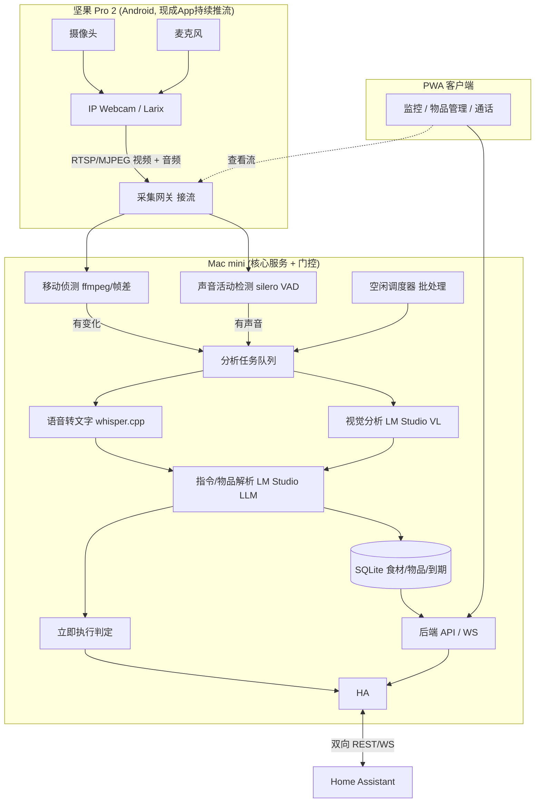

# SmartButler 家庭智能管家 — 技术方案

> 一个完全本地化、注重隐私的家庭智能管家系统。核心是家庭食材 / 物品及其到期时间的管理，支持多渠道录入，并与 Home Assistant 双向集成。

## 1. 项目目标

构建一个完全本地化、注重隐私的家庭智能管家系统：

- **核心**：家庭食材 / 物品及其到期时间的管理 + 到期提醒。
- 支持多渠道录入：界面手动输入、语音转文字、视频 / 拍照识别。
- 利用 Mac mini (24G) 上的本地大模型（LM Studio）进行分析。
- 用闲置 Android 手机（坚果 Pro 2，Android 7）作为采集节点，通过现成推流 App 持续推流到 Mac mini，门控逻辑集中在 Mac mini 侧（移动侦测 + VAD，有变化才触发分析）。
- 通过 PWA 查看监控与管理，并与 Home Assistant 双向集成。
- 后期扩展食谱推荐和采购推荐。

## 2. 需求（已确认）

- 核心诉求：家庭食材 / 物品管理 + 到期提醒。
- 录入全渠道：实时视频识别、录音转文字入库、界面手动输入（第一版语音仅"转文字入库"，不做对话 / 唤醒词）。
- 采集节点：Android 手机（坚果 Pro 2 / Android 7），固定放置当摄像头 + 麦克风；第一版用现成推流 App（如 IP Webcam / Larix），不自写 App，不用开发板。
- 门控（有变化才分析）放 Mac mini 侧：移动侦测 + VAD，仅在检测到变化时触发 AI 分析与记录。
- 本地模型：LM Studio（OpenAI 兼容 API，含视觉与 embeddings），需任务队列串行化 + 空闲批处理调度。
- 数据存储：本地 SQLite。
- HA 已安装、具 REST / WebSocket API；需双向集成（读状态、控制实体、收发事件）。
- 交付 PWA：监控查看、通话、物品管理。
- 架构一步到位设计，实现分阶段。

## 3. 技术栈（已确认：全 Node / TypeScript）

统一技术栈，后端 / 前端 / 采集网关全部使用 Node / TypeScript，部署简单，与 PWA 同语言。

| 层 | 选型 | 说明 |
| --- | --- | --- |
| 后端 API / WS | Node + Fastify（或 Express）+ `ws` | 轻量，WebSocket 做实时推送 |
| 数据库 | SQLite + Drizzle ORM（或 `better-sqlite3`） | 纯本地、单机、隐私 |
| 前端 | PWA：React + Vite + Service Worker | 可安装，监控 / 物品管理 / 通话 |
| 本地大模型接入 | 官方 `openai` npm 包，指向 LM Studio | 文本 / 视觉 / embeddings |
| STT 语音转文字 | whisper.cpp（独立进程，Node spawn 调用） | 与语言无关的外部二进制 |
| 门控 - 移动侦测 | ffmpeg 场景检测（`select='gt(scene,…)'`）或帧差 | OpenCV 的 Node 替代路径 |
| 门控 - VAD | `onnxruntime-node` 跑 silero-vad（或能量阈值） | 声音活动检测 |
| 拉流解复用 | ffmpeg 子进程 | 接收手机推流，输出视频帧 + 音频 PCM |
| 任务队列 / 调度 | Node 异步 + `p-queue` 等 | 串行化 LM Studio 请求，空闲批处理 |
| HA 集成 | REST 用 fetch，WS 用 `home-assistant-js-websocket` | 双向集成 |

> **技术栈决策说明**：整个系统全 Node 可行。唯一短板是门控中的移动侦测与 VAD（Python 的 OpenCV / silero 生态更成熟），因此采用 ffmpeg 场景检测 + onnxruntime-node 跑 silero VAD 作为 Node 侧替代路径。若后期门控质量不满意，可平滑演进为"Node 为主 + 独立 Python 门控微服务"。

## 4. 调研结论（Background）

- **LM Studio** 提供 `http://localhost:1234/v1` OpenAI 兼容端点，支持 `chat/completions`（文本 + 图片）与 `embeddings`；llama.cpp 后端并发有限，需串行队列 + 模型按需加载。
- **Home Assistant** REST API 用 `Authorization: Bearer <长期令牌>`：`GET /api/states/<entity>` 读状态，`POST /api/services/<domain>/<service>` 控制实体；WebSocket API 订阅事件做双向集成。
- **24G 内存模型规划**：视觉 Qwen2.5-VL-7B（约 6–8G），文本解析 / 意图 Qwen2.5-7B-Instruct（约 5–6G），STT 用 whisper.cpp / faster-whisper（独立进程）。视觉 + 文本不宜同时高并发常驻，用队列调度，空闲做批处理。
- **Android 7（坚果 Pro 2）**：现成推流 App（IP Webcam 推 MJPEG / RTSP + 音频）兼容良好；门控放 Mac mini 侧可规避老机型 App 能力限制，与"算力集中 Mac mini"架构一致。

## 5. 硬件清单（最终）

| 角色 | 设备 / 软件 | 成本 | 备注 |
| --- | --- | --- | --- |
| 采集节点 | 坚果 Pro 2（Android 7，已有） | 零成本 | 固定放置，建议常供电、注意散热 |
| 采集软件 | 现成推流 App（IP Webcam 或 Larix Broadcaster） | 零成本 | 持续推 MJPEG / RTSP 视频 + 音频到局域网 |
| 核心服务 | Mac mini（24G，已有） | 零成本 | 跑 LM Studio、后端、门控、whisper、调度器 |
| 智能家居 | Home Assistant（已安装） | 零成本 | 双向集成 |
| 本地大模型 | LM Studio（已装） | 零成本 | OpenAI 兼容 API |

**后续可选**：第二台旧手机做多点采集；专用小音箱供 TTS（第一版不需要）。

## 6. 架构

### 数据流

坚果 Pro 2（现成 App 持续推流 RTSP / MJPEG 视频 + 音频）
→ Mac mini 采集网关（接流解复用）
→ 门控（移动侦测 + VAD，有变化才产生事件）
→ 分析任务队列
→ [视觉分析 LM Studio VL / 语音转文字 whisper.cpp]
→ 指令 / 物品解析 LM Studio LLM
→ [SQLite 入库 / 立即执行判定 → HA]。

空闲调度器消费延后任务做批处理。后端 API / WS 对接 PWA（监控 / 物品管理 / 通话）和 HA（双向 REST / WS）。

### 架构图

## 7. 任务拆分（Task Breakdown）

### Task 1：项目骨架与核心数据模型
- **目标**：搭建后端项目结构，定义 SQLite 模型（Item、Category、ExpiryRecord、EventLog）。
- **指南**：定义物品 名称 / 数量 / 分类 / 购入日期 / 保质期 / 到期日 / 存放位置；数据库初始化脚手架。
- **测试**：模型 CRUD 与到期日计算单测。
- **Demo**：初始化数据库，插入几条食材，查询"即将到期"列表。

### Task 2：物品管理 REST API + 到期提醒逻辑
- **目标**：物品增删改查 API + 到期查询端点。
- **指南**：按分类 / 位置 / 到期范围过滤；实现"N 天内到期"。
- **测试**：CRUD 与到期过滤集成测试。
- **Demo**：HTTP 增删查物品，`/items/expiring?days=3` 返回三天内到期清单。

### Task 3：最小 PWA — 物品管理界面（手动录入渠道）
- **目标**：React PWA，手动增删改查物品、到期看板，Service Worker 可安装。
- **指南**：对接 Task 2 API；临期高亮；表单录入。
- **测试**：组件测试 + 端到端冒烟。
- **Demo**：安装 PWA，手动添加"两盒牛奶 保质期下周五"，看板显示倒计时。（核心食材管理闭环）

### Task 4：LM Studio 接入层 + 任务队列调度器
- **目标**：封装 LM Studio API 调用（文本 / 视觉 / embeddings），实现串行任务队列 + 空闲批处理调度。
- **指南**：统一客户端处理模型按需加载 / 串行化；队列分"立即"与"延后"优先级；空闲调度器消费延后任务。
- **测试**：mock 响应测队列优先级与重试；真实 LM Studio 联调一次。
- **Demo**：提交立即任务 + 延后任务，日志显示立即优先、延后在空闲处理。

### Task 5：语音转文字入库渠道（音频 → whisper → 解析 → 入库）
- **目标**：音频 → whisper.cpp 转文字 → LM Studio 结构化解析 → 写 DB。
- **指南**：先用上传音频 / Mac 麦克风跑通；LLM 用 JSON schema 解析"我买了两盒牛奶，保质期到下周五"。
- **测试**：固定音频样本转写与解析准确性测试。
- **Demo**：对 Mac 麦克风说一句，PWA 看板出现对应条目。（语音录入闭环）

### Task 6：Android 采集推流接入 + Mac mini 采集网关
- **目标**：手机用现成 App（IP Webcam / Larix）推 RTSP / MJPEG 视频 + 音频到局域网；Mac mini 实现采集网关接收并解复用音视频。
- **指南**：文档化手机 App 配置（分辨率 / 码率 / 地址）；网关用 ffmpeg 拉流，输出视频帧与音频 PCM 两路给后续模块。
- **测试**：接流稳定性与断线重连测试。
- **Demo**：手机 App 开始推流，Mac mini 网关实时显示收到的帧率与音频电平。

### Task 7：Mac mini 侧门控（移动侦测 + VAD）
- **目标**：在网关输出上做移动侦测与 VAD，仅在"有变化"时产生事件推入分析队列。
- **指南**：ffmpeg 场景检测 / 帧差做移动侦测，silero VAD（onnxruntime-node）/ 能量阈值做 VAD；可调灵敏度、冷却时间、最小事件时长，避免误触发。
- **测试**：静止 / 移动、安静 / 说话场景验证只在变化时产生事件；误报率评估。
- **Demo**：画面有人走动才生成视频分析事件，静止不生成；说话才生成音频事件。（"有变化才采集"闭环）

### Task 8：视频识别入库渠道（门控事件 → VL 识别 → 入库）
- **目标**：门控的视频事件抽关键帧 → LM Studio VL 识别物品 / 估计到期 → 入库；低置信标记待确认。
- **指南**：关键帧经 Task 4 队列调用视觉模型；结构化输出物品信息；待确认项在 PWA 可人工校正。
- **测试**：样本图片识别到入库链路测试。
- **Demo**：手机对着购物袋，PWA 看板自动出现识别物品（含待确认标记）。（视频识别闭环）

### Task 9：PWA 实时监控查看 + 通话
- **目标**：PWA 增加实时监控画面查看 + 双向音频对讲。
- **指南**：监控用网关转发流（MJPEG 起步，后续可升级 WebRTC 低延迟）；通话建立 PWA ↔ 手机 音频通道。
- **测试**：延迟与连通性测试。
- **Demo**：手机 PWA 看到采集手机的实时画面，并能对讲喊话。

### Task 10：Home Assistant 双向集成
- **目标**：封装 HA REST / WebSocket 客户端，读实体状态、控制实体、订阅事件；把"物品临期"等状态暴露给 HA。
- **指南**：Bearer 令牌配置；控制灯 / 开关；订阅 HA 事件触发系统逻辑；临期提醒作为 HA 可消费状态 / 通知。
- **测试**：mock HA API 测控制与事件；真实 HA 联调一个实体。
- **Demo**：PWA 点按钮控制 HA 的灯；物品临期时 HA 收到通知 / 触发自动化。

### Task 11：指令"立即执行 vs 延后分析"路由 + 行为日志
- **目标**：解析层区分需立即执行指令（如"关客厅灯"→ HA）与需记录项，记录行为日志为后续习惯学习铺垫。
- **指南**：LLM 分类意图；立即类走 HA / 动作执行，记录类入库；行为日志为后期食谱 / 采购推荐沉淀数据。
- **测试**：意图分类测试集覆盖立即 / 延后。
- **Demo**："关掉客厅灯"立即执行；"冰箱里还有三个鸡蛋"记录入库；路由正确。

### Task 12：系统整合、部署脚本与文档
- **目标**：串起 Android 采集、Mac mini 后端 / 网关 / 门控 / whisper / 调度器、PWA、LM Studio、HA 全链路；提供启动脚本与部署文档。
- **指南**：进程编排；手机 App 配置文档；配置集中管理；端到端冒烟脚本。
- **测试**：全链路端到端（手动 / 语音 / 视频三渠道 + HA 控制 + 监控）。
- **Demo**：一键启动，演示三种录入方式入库 + 到期提醒 + HA 控制 + PWA 监控的完整闭环。

## 8. 后期扩展（本计划之外，占位）

- 食谱推荐（现有食材 + 临期优先）
- 采购推荐（消耗习惯）
- 唤醒词 + 完整语音对话
- 自写 Android 采集 App（带边缘门控 / 屏幕当面板，省电）
- 多点采集
- 独立音箱 TTS

## 9. 实施阶段建议

- **阶段一（核心闭环）**：Task 1 → 2 → 3，先让食材 / 物品管理可用（手动录入渠道）。
- **阶段二（AI 接入 + 语音）**：Task 4 → 5，接入 LM Studio，打通语音录入渠道。
- **阶段三（采集 + 监控）**：Task 6 → 7 → 8 → 9，接入手机采集、门控、视频识别与监控。
- **阶段四（集成）**：Task 10 → 11 → 12，HA 双向集成、指令路由与全系统整合。
